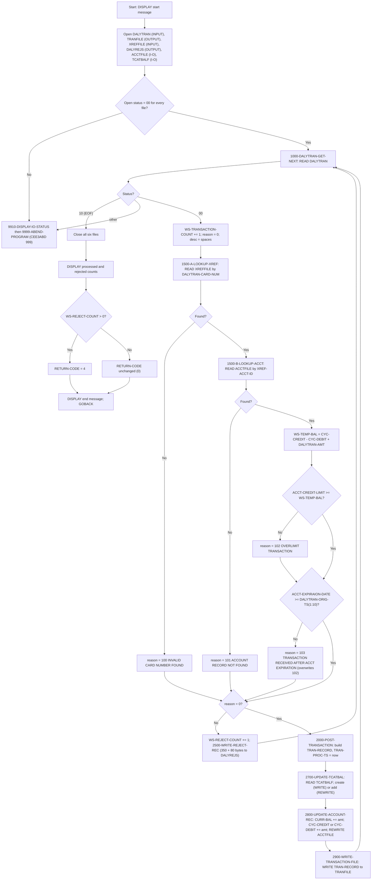

# CBTRN02C — Daily Transaction Posting (Batch)

| | |
|---|---|
| Program | `app/cbl/CBTRN02C.cbl` |
| Job / step | `app/jcl/POSTTRAN.jcl` — `STEP15 EXEC PGM=CBTRN02C` (line 23) |
| Type | Batch COBOL, sequential driver over VSAM KSDS masters |
| Copybooks | `CVTRA06Y` (DALYTRAN-RECORD), `CVTRA05Y` (TRAN-RECORD), `CVACT03Y` (CARD-XREF-RECORD), `CVACT01Y` (ACCOUNT-RECORD), `CVTRA01Y` (TRAN-CAT-BAL-RECORD) |

This document is the functional and technical specification of `CBTRN02C` intended to drive a byte- and logic-exact re-implementation on a modernized platform. Line numbers refer to the files in this repository at the time of writing.

---

## 1. Purpose

`CBTRN02C` reads the daily transaction file (`DALYTRAN`) record by record. For each record it:

1. validates the card number against the card cross-reference file and the resolved account against the account master (credit limit and expiration checks), then
2. **either posts** the transaction — writing it to the transaction master (`TRANFILE`), creating/updating the per-account, per-type, per-category running balance (`TCATBALF`) and updating the account's current balance and cycle credit/debit buckets (`ACCTFILE`) —
3. **or rejects** it — writing the original 350-byte record plus an 80-byte reason trailer to the daily rejects file (`DALYREJS`).

At end of file it prints processed/rejected counts and sets `RETURN-CODE = 4` if any record was rejected.

---

## 2. Files / Datasets

Source: `SELECT` clauses `CBTRN02C.cbl` lines 29–61, `FD`s lines 66–97, `OPEN` paragraphs lines 236–343, DD statements `POSTTRAN.jcl` lines 28–42.

| DD name | COBOL file / FD record | Organization / access | Open mode | Record key (FD) | Record length | Dataset (`POSTTRAN.jcl`) |
|---|---|---|---|---|---|---|
| `DALYTRAN` | `DALYTRAN-FILE` / `FD-TRAN-RECORD` | SEQUENTIAL / SEQUENTIAL | `INPUT` (l.238) | — | 350 | `AWS.M2.CARDDEMO.DALYTRAN.PS` (`DISP=SHR`) |
| `TRANFILE` | `TRANSACT-FILE` / `FD-TRANFILE-REC` | INDEXED / RANDOM | **`OUTPUT`** (l.256) — file is fully rewritten every run | `FD-TRANS-ID` `PIC X(16)` | 350 | `AWS.M2.CARDDEMO.TRANSACT.VSAM.KSDS` (`DISP=SHR`) |
| `XREFFILE` | `XREF-FILE` / `FD-XREFFILE-REC` | INDEXED / RANDOM | `INPUT` (l.275) | `FD-XREF-CARD-NUM` `PIC X(16)` | 50 | `AWS.M2.CARDDEMO.CARDXREF.VSAM.KSDS` (`DISP=SHR`) |
| `DALYREJS` | `DALYREJS-FILE` / `FD-REJS-RECORD` | SEQUENTIAL / SEQUENTIAL | `OUTPUT` (l.293) | — | 430 | `AWS.M2.CARDDEMO.DALYREJS(+1)` — new GDG generation, `DISP=(NEW,CATLG,DELETE)`, `DCB=(RECFM=F,LRECL=430,BLKSIZE=0)` |
| `ACCTFILE` | `ACCOUNT-FILE` / `FD-ACCTFILE-REC` | INDEXED / RANDOM | `I-O` (l.311) | `FD-ACCT-ID` `PIC 9(11)` | 300 | `AWS.M2.CARDDEMO.ACCTDATA.VSAM.KSDS` (`DISP=SHR`) |
| `TCATBALF` | `TCATBAL-FILE` / `FD-TRAN-CAT-BAL-RECORD` | INDEXED / RANDOM | `I-O` (l.329) | `FD-TRAN-CAT-KEY` = `FD-TRANCAT-ACCT-ID 9(11)` + `FD-TRANCAT-TYPE-CD X(02)` + `FD-TRANCAT-CD 9(04)` (17 bytes) | 50 | `AWS.M2.CARDDEMO.TCATBALF.VSAM.KSDS` (`DISP=SHR`) |

Each file has its own two-byte `FILE STATUS` item (`DALYTRAN-STATUS`, `TRANFILE-STATUS`, `XREFFILE-STATUS`, `DALYREJS-STATUS`, `ACCTFILE-STATUS`, `TCATBALF-STATUS`; lines 103–129). Any `OPEN` or `CLOSE` status other than `'00'` abends the program (see §9).

---

## 3. Record Layouts (byte-exact)

Conventions for the target implementation:

* `PIC X(n)` — fixed-width character, space padded, EBCDIC on the mainframe.
* `PIC 9(n)` — unsigned zoned decimal, n digits, zero padded.
* `PIC S9(p)V99` — **signed zoned decimal** with an implied two-digit scale, occupying `p + 2` bytes (sign is carried in the zone nibble of the last byte — no separate sign byte). Map to a fixed-scale decimal type (e.g. Java `BigDecimal` with `scale = 2`, precision `p + 2`), preserving sign and never using binary floating point.
* Offsets below are 0-based byte offsets within the record.

### 3.1 `DALYTRAN-RECORD` — `app/cpy/CVTRA06Y.cpy` (350 bytes, input)

| Offset | Len | Field | PIC |
|---|---|---|---|
| 0 | 16 | `DALYTRAN-ID` | `X(16)` |
| 16 | 2 | `DALYTRAN-TYPE-CD` | `X(02)` |
| 18 | 4 | `DALYTRAN-CAT-CD` | `9(04)` |
| 22 | 10 | `DALYTRAN-SOURCE` | `X(10)` |
| 32 | 100 | `DALYTRAN-DESC` | `X(100)` |
| 132 | 11 | `DALYTRAN-AMT` | `S9(09)V99` |
| 143 | 9 | `DALYTRAN-MERCHANT-ID` | `9(09)` |
| 152 | 50 | `DALYTRAN-MERCHANT-NAME` | `X(50)` |
| 202 | 50 | `DALYTRAN-MERCHANT-CITY` | `X(50)` |
| 252 | 10 | `DALYTRAN-MERCHANT-ZIP` | `X(10)` |
| 262 | 16 | `DALYTRAN-CARD-NUM` | `X(16)` |
| 278 | 26 | `DALYTRAN-ORIG-TS` | `X(26)` |
| 304 | 26 | `DALYTRAN-PROC-TS` | `X(26)` |
| 330 | 20 | `FILLER` | `X(20)` |

The program's own `FD-TRAN-RECORD` (lines 67–69) views the same 350 bytes as `FD-TRAN-ID X(16)` + `FD-CUST-DATA X(334)`; the `READ ... INTO DALYTRAN-RECORD` (line 346) copies the buffer into the copybook layout.

### 3.2 `TRAN-RECORD` — `app/cpy/CVTRA05Y.cpy` (350 bytes, TRANFILE output)

Identical layout to `DALYTRAN-RECORD` with the `TRAN-` prefix:

| Offset | Len | Field | PIC |
|---|---|---|---|
| 0 | 16 | `TRAN-ID` (VSAM key, = `FD-TRANS-ID`) | `X(16)` |
| 16 | 2 | `TRAN-TYPE-CD` | `X(02)` |
| 18 | 4 | `TRAN-CAT-CD` | `9(04)` |
| 22 | 10 | `TRAN-SOURCE` | `X(10)` |
| 32 | 100 | `TRAN-DESC` | `X(100)` |
| 132 | 11 | `TRAN-AMT` | `S9(09)V99` |
| 143 | 9 | `TRAN-MERCHANT-ID` | `9(09)` |
| 152 | 50 | `TRAN-MERCHANT-NAME` | `X(50)` |
| 202 | 50 | `TRAN-MERCHANT-CITY` | `X(50)` |
| 252 | 10 | `TRAN-MERCHANT-ZIP` | `X(10)` |
| 262 | 16 | `TRAN-CARD-NUM` | `X(16)` |
| 278 | 26 | `TRAN-ORIG-TS` | `X(26)` |
| 304 | 26 | `TRAN-PROC-TS` | `X(26)` |
| 330 | 20 | `FILLER` | `X(20)` |

### 3.3 `CARD-XREF-RECORD` — `app/cpy/CVACT03Y.cpy` (50 bytes, XREFFILE)

| Offset | Len | Field | PIC |
|---|---|---|---|
| 0 | 16 | `XREF-CARD-NUM` (VSAM key, = `FD-XREF-CARD-NUM`) | `X(16)` |
| 16 | 9 | `XREF-CUST-ID` | `9(09)` |
| 25 | 11 | `XREF-ACCT-ID` | `9(11)` |
| 36 | 14 | `FILLER` | `X(14)` |

### 3.4 `ACCOUNT-RECORD` — `app/cpy/CVACT01Y.cpy` (300 bytes, ACCTFILE)

| Offset | Len | Field | PIC |
|---|---|---|---|
| 0 | 11 | `ACCT-ID` (VSAM key, = `FD-ACCT-ID`) | `9(11)` |
| 11 | 1 | `ACCT-ACTIVE-STATUS` | `X(01)` |
| 12 | 12 | `ACCT-CURR-BAL` | `S9(10)V99` |
| 24 | 12 | `ACCT-CREDIT-LIMIT` | `S9(10)V99` |
| 36 | 12 | `ACCT-CASH-CREDIT-LIMIT` | `S9(10)V99` |
| 48 | 10 | `ACCT-OPEN-DATE` | `X(10)` |
| 58 | 10 | `ACCT-EXPIRAION-DATE` (sic — misspelled in copybook) | `X(10)` |
| 68 | 10 | `ACCT-REISSUE-DATE` | `X(10)` |
| 78 | 12 | `ACCT-CURR-CYC-CREDIT` | `S9(10)V99` |
| 90 | 12 | `ACCT-CURR-CYC-DEBIT` | `S9(10)V99` |
| 102 | 10 | `ACCT-ADDR-ZIP` | `X(10)` |
| 112 | 10 | `ACCT-GROUP-ID` | `X(10)` |
| 122 | 178 | `FILLER` | `X(178)` |

`ACCT-ACTIVE-STATUS` and `ACCT-CASH-CREDIT-LIMIT` are **not** examined by this program. Dates are `X(10)` strings, by convention `YYYY-MM-DD`.

### 3.5 `TRAN-CAT-BAL-RECORD` — `app/cpy/CVTRA01Y.cpy` (50 bytes, TCATBALF)

| Offset | Len | Field | PIC |
|---|---|---|---|
| 0 | 11 | `TRANCAT-ACCT-ID` | `9(11)` |
| 11 | 2 | `TRANCAT-TYPE-CD` | `X(02)` |
| 13 | 4 | `TRANCAT-CD` | `9(04)` |
| 17 | 11 | `TRAN-CAT-BAL` | `S9(09)V99` |
| 28 | 22 | `FILLER` | `X(22)` |

Bytes 0–16 form the group item `TRAN-CAT-KEY` (VSAM key, = `FD-TRAN-CAT-KEY`).

### 3.6 `REJECT-RECORD` / `WS-VALIDATION-TRAILER` — `CBTRN02C.cbl` lines 176–182 (430 bytes, DALYREJS output)

| Offset | Len | Field | PIC | Content |
|---|---|---|---|---|
| 0 | 350 | `REJECT-TRAN-DATA` | `X(350)` | verbatim copy of the input `DALYTRAN-RECORD` |
| 350 | 4 | `WS-VALIDATION-FAIL-REASON` | `9(04)` | reason code, zero padded (`0100`, `0101`, `0102`, `0103`) |
| 354 | 76 | `WS-VALIDATION-FAIL-REASON-DESC` | `X(76)` | reason text, space padded |

430 = 350 + 80, matching `LRECL=430` in the JCL.

### 3.7 Working-storage items that affect behavior (lines 131–190)

| Item | PIC | Role |
|---|---|---|
| `APPL-RESULT` (`88 APPL-AOK = 0`, `88 APPL-EOF = 16`) | `S9(9) COMP` | per-I/O result; 0 ok, 12 error, 16 EOF |
| `END-OF-FILE` | `X(01)` `'N'` | loop control |
| `WS-TRANSACTION-COUNT`, `WS-REJECT-COUNT` | `9(09)` | counters printed at end |
| `WS-TEMP-BAL` | `S9(09)V99` | scratch for the overlimit computation (note: 9 integer digits vs. 10 in the account fields — see §10) |
| `WS-CREATE-TRANCAT-REC` | `X(01)` | `'Y'` when the TCATBAL record must be created |
| `COBOL-TS`, `DB2-FORMAT-TS` | see §7 | timestamp work areas |
| `ABCODE`, `TIMING` | `S9(9) BINARY` | arguments to `CEE3ABD` |
| `IO-STATUS`, `IO-STATUS-04`, `TWO-BYTES-BINARY` | | file-status display (§9) |

---

## 4. Main Flow

Procedure division, lines 193–234.

1. `DISPLAY 'START OF EXECUTION OF PROGRAM CBTRN02C'`.
2. Open all six files in order `DALYTRAN`, `TRANFILE`, `XREFFILE`, `DALYREJS`, `ACCTFILE`, `TCATBALF` (`0000-` … `0500-` paragraphs). Any non-`'00'` status → display message, `9910-DISPLAY-IO-STATUS`, `9999-ABEND-PROGRAM`.
3. `PERFORM UNTIL END-OF-FILE = 'Y'`:
   1. `1000-DALYTRAN-GET-NEXT` — `READ DALYTRAN-FILE INTO DALYTRAN-RECORD`. Status `'00'` → continue; `'10'` → set `END-OF-FILE = 'Y'`; anything else → abend.
   2. If not EOF: `ADD 1 TO WS-TRANSACTION-COUNT`; `MOVE 0 TO WS-VALIDATION-FAIL-REASON`; `MOVE SPACES TO WS-VALIDATION-FAIL-REASON-DESC`.
   3. `1500-VALIDATE-TRAN` (§5).
   4. If `WS-VALIDATION-FAIL-REASON = 0` → `2000-POST-TRANSACTION` (§6); else `ADD 1 TO WS-REJECT-COUNT` and `2500-WRITE-REJECT-REC` (§8).
4. Close all six files (`9000-` … `9500-`); any non-`'00'` status → abend.
5. `DISPLAY 'TRANSACTIONS PROCESSED :' WS-TRANSACTION-COUNT` and `DISPLAY 'TRANSACTIONS REJECTED  :' WS-REJECT-COUNT` (counters printed as 9 zero-padded digits).
6. If `WS-REJECT-COUNT > 0` → `MOVE 4 TO RETURN-CODE`.
7. `DISPLAY 'END OF EXECUTION OF PROGRAM CBTRN02C'`; `GOBACK`.

Processing is strictly single-pass and sequential; every record is either posted or rejected (or the program abends). There is no commit/rollback — updates to the VSAM files are applied immediately as each record is processed.



---

## 5. Validation Rules

`1500-VALIDATE-TRAN` (lines 370–378) performs `1500-A-LOOKUP-XREF`; only if that left the reason at 0 does it perform `1500-B-LOOKUP-ACCT`. Reason 109 is not raised during validation but during posting (§6.3); it is listed here because it shares the reason-code space.

| Code | `WS-VALIDATION-FAIL-REASON-DESC` (exact text) | Where | Condition | Notes |
|---|---|---|---|---|
| `100` | `INVALID CARD NUMBER FOUND` | `1500-A-LOOKUP-XREF` l.380–392 | `READ XREF-FILE` with key `FD-XREF-CARD-NUM = DALYTRAN-CARD-NUM` raises `INVALID KEY` (no cross-reference record for the card). | Stops further validation; account lookup is skipped. |
| `101` | `ACCOUNT RECORD NOT FOUND` | `1500-B-LOOKUP-ACCT` l.393–399 | `READ ACCOUNT-FILE` with key `FD-ACCT-ID = XREF-ACCT-ID` raises `INVALID KEY`. | |
| `102` | `OVERLIMIT TRANSACTION` | `1500-B-LOOKUP-ACCT` l.403–413 | `WS-TEMP-BAL = ACCT-CURR-CYC-CREDIT − ACCT-CURR-CYC-DEBIT + DALYTRAN-AMT`; fail when `ACCT-CREDIT-LIMIT < WS-TEMP-BAL`. | Uses the cycle buckets, **not** `ACCT-CURR-BAL`. Signed arithmetic, scale 2. |
| `103` | `TRANSACTION RECEIVED AFTER ACCT EXPIRATION` | `1500-B-LOOKUP-ACCT` l.414–420 | Fail when `ACCT-EXPIRAION-DATE < DALYTRAN-ORIG-TS(1:10)` — a **lexical (alphanumeric) string comparison** of two 10-character fields, not a date comparison. | Evaluated **after** 102 in the same `NOT INVALID KEY` block as an independent `IF`, so when both fail the record is rejected with **103**, and 102 is lost. |
| `109` | `ACCOUNT RECORD NOT FOUND` | `2800-UPDATE-ACCOUNT-REC` l.554–559 | `REWRITE FD-ACCTFILE-REC` raises `INVALID KEY` during posting. | Same description text as 101. See §6.3 and §10 for the actual (non-)effect of this code. |

Behavioral details to reproduce:

* A record with an unknown card is never checked against the account master; a record with a known card but missing account is never checked for limit/expiration.
* The 102/103 checks are **not** mutually exclusive `IF`/`ELSE IF`; both run, and the last one to fail wins (103 over 102).
* Only one reason code and one description are ever written to the reject trailer.
* Validation has no side effects on any file.

---

## 6. Posting Logic

### 6.1 `2000-POST-TRANSACTION` (lines 424–444)

Builds `TRAN-RECORD` from `DALYTRAN-RECORD` field by field (same PIC on both sides, so the moves are byte copies):

| Target (`TRAN-RECORD`) | Source |
|---|---|
| `TRAN-ID` | `DALYTRAN-ID` |
| `TRAN-TYPE-CD` | `DALYTRAN-TYPE-CD` |
| `TRAN-CAT-CD` | `DALYTRAN-CAT-CD` |
| `TRAN-SOURCE` | `DALYTRAN-SOURCE` |
| `TRAN-DESC` | `DALYTRAN-DESC` |
| `TRAN-AMT` | `DALYTRAN-AMT` |
| `TRAN-MERCHANT-ID` | `DALYTRAN-MERCHANT-ID` |
| `TRAN-MERCHANT-NAME` | `DALYTRAN-MERCHANT-NAME` |
| `TRAN-MERCHANT-CITY` | `DALYTRAN-MERCHANT-CITY` |
| `TRAN-MERCHANT-ZIP` | `DALYTRAN-MERCHANT-ZIP` |
| `TRAN-CARD-NUM` | `DALYTRAN-CARD-NUM` |
| `TRAN-ORIG-TS` | `DALYTRAN-ORIG-TS` |
| `TRAN-PROC-TS` | `DB2-FORMAT-TS` produced by `Z-GET-DB2-FORMAT-TIMESTAMP` (§7) — the input `DALYTRAN-PROC-TS` is **ignored** |
| `FILLER` (bytes 330–349) | not moved; whatever `TRAN-RECORD` working storage holds (initially spaces/low-values per compiler default; treat as spaces) |

Then, in this order: `2700-UPDATE-TCATBAL` → `2800-UPDATE-ACCOUNT-REC` → `2900-WRITE-TRANSACTION-FILE`.

### 6.2 `2700-UPDATE-TCATBAL` (lines 467–542)

Key build: `FD-TRANCAT-ACCT-ID = XREF-ACCT-ID`, `FD-TRANCAT-TYPE-CD = DALYTRAN-TYPE-CD`, `FD-TRANCAT-CD = DALYTRAN-CAT-CD`.

1. `MOVE 'N' TO WS-CREATE-TRANCAT-REC`; `READ TCATBAL-FILE INTO TRAN-CAT-BAL-RECORD`.
   * `INVALID KEY` → `DISPLAY 'TCATBAL record not found for key : ' FD-TRAN-CAT-KEY '.. Creating.'`; set flag `'Y'`.
2. Status check: `TCATBALF-STATUS = '00' OR '23'` is OK; any other status → display `'ERROR READING TRANSACTION BALANCE FILE'`, `9910-DISPLAY-IO-STATUS`, abend.
3. If flag `'Y'` → `2700-A-CREATE-TCATBAL-REC` (lines 503–524):
   * `INITIALIZE TRAN-CAT-BAL-RECORD` (numeric fields → 0, alphanumeric → spaces),
   * `TRANCAT-ACCT-ID = XREF-ACCT-ID`, `TRANCAT-TYPE-CD = DALYTRAN-TYPE-CD`, `TRANCAT-CD = DALYTRAN-CAT-CD`,
   * `ADD DALYTRAN-AMT TO TRAN-CAT-BAL` — i.e. `TRAN-CAT-BAL = DALYTRAN-AMT` on create,
   * `WRITE FD-TRAN-CAT-BAL-RECORD FROM TRAN-CAT-BAL-RECORD`; status ≠ `'00'` → `'ERROR WRITING TRANSACTION BALANCE FILE'`, abend.
4. Else → `2700-B-UPDATE-TCATBAL-REC` (lines 526–542):
   * `ADD DALYTRAN-AMT TO TRAN-CAT-BAL` (`+=`),
   * `REWRITE FD-TRAN-CAT-BAL-RECORD FROM TRAN-CAT-BAL-RECORD`; status ≠ `'00'` → `'ERROR REWRITING TRANSACTION BALANCE FILE'`, abend.

`TRAN-CAT-BAL` is `S9(09)V99`; the sum is signed and truncates (not rounds) to two decimals — inputs already have scale 2 so no rounding occurs, but overflow past 9 integer digits would be silently truncated (high-order digits lost) because no `ON SIZE ERROR` is coded.

### 6.3 `2800-UPDATE-ACCOUNT-REC` (lines 545–560)

Operates on the `ACCOUNT-RECORD` copy that was read in `1500-B-LOOKUP-ACCT`; the account is **not** re-read.

```
ACCT-CURR-BAL += DALYTRAN-AMT
IF DALYTRAN-AMT >= 0           (zero counts as credit)
    ACCT-CURR-CYC-CREDIT += DALYTRAN-AMT
ELSE
    ACCT-CURR-CYC-DEBIT  += DALYTRAN-AMT   (adds a negative number, so the debit bucket decreases / goes negative)
REWRITE FD-ACCTFILE-REC FROM ACCOUNT-RECORD
    INVALID KEY -> WS-VALIDATION-FAIL-REASON = 109, DESC = 'ACCOUNT RECORD NOT FOUND'
```

Notes:

* The record key `FD-ACCT-ID` still holds `XREF-ACCT-ID` from the validation read, so the `REWRITE` targets the same record.
* There is **no** file-status check after the `REWRITE` other than the `INVALID KEY` clause. A non-`'00'`, non-invalid-key status (e.g. `'9x'`) is silently ignored.
* When `INVALID KEY` fires, reason 109 is set but **nothing acts on it**: the program does not write a reject record, does not increment `WS-REJECT-COUNT`, and proceeds to `2900-WRITE-TRANSACTION-FILE`. The reason is reset to 0 at the top of the next loop iteration. The TCATBAL update from §6.2 has already been written. Net effect: transaction is written to TRANFILE and TCATBALF but the account update is lost, with no external signal. See §10.

### 6.4 `2900-WRITE-TRANSACTION-FILE` (lines 562–579)

`WRITE FD-TRANFILE-REC FROM TRAN-RECORD`. Status ≠ `'00'` → `'ERROR WRITING TO TRANSACTION FILE'`, `9910-DISPLAY-IO-STATUS`, abend. Because the file was opened `OUTPUT`, a duplicate `TRAN-ID` within the run yields status `'22'` and therefore an abend.

---

## 7. Timestamp Format — `Z-GET-DB2-FORMAT-TIMESTAMP` (lines 692–705; work areas lines 149–174)

`FUNCTION CURRENT-DATE` (21 chars: `YYYYMMDDhhmmsscc` + `±hhmm`) is moved to `COBOL-TS`, which splits it as `COB-YYYY X(4)`, `COB-MM X(2)`, `COB-DD X(2)`, `COB-HH X(2)`, `COB-MIN X(2)`, `COB-SS X(2)`, `COB-MIL X(2)` (hundredths of a second), `COB-REST X(5)` (unused).

`DB2-FORMAT-TS` (26 chars) is then assembled as:

```
YYYY-MM-DD-HH.MM.SS.cc0000
 4  1 2 1 2 1 2 1 2 1 2 1 2  4   = 26
```

| Positions (1-based) | Field | Value |
|---|---|---|
| 1–4 | `DB2-YYYY` | year |
| 5 | `DB2-STREEP-1` | `-` |
| 6–7 | `DB2-MM` | month |
| 8 | `DB2-STREEP-2` | `-` |
| 9–10 | `DB2-DD` | day |
| 11 | `DB2-STREEP-3` | `-` |
| 12–13 | `DB2-HH` | hour (24h) |
| 14 | `DB2-DOT-1` | `.` |
| 15–16 | `DB2-MIN` | minute |
| 17 | `DB2-DOT-2` | `.` |
| 18–19 | `DB2-SS` | second |
| 20 | `DB2-DOT-3` | `.` |
| 21–22 | `DB2-MIL` | hundredths of a second (`PIC 9(2)`) |
| 23–26 | `DB2-REST` | literal `0000` |

Example: `2024-03-15-14.07.09.420000`. Local system time is used (no time-zone conversion). Every posted transaction in a run gets the clock value at the moment it is posted; this is the only non-deterministic output of the program.

---

## 8. Reject Handling — `2500-WRITE-REJECT-REC` (lines 446–465)

```
MOVE DALYTRAN-RECORD        TO REJECT-TRAN-DATA        (350 bytes, unchanged input)
MOVE WS-VALIDATION-TRAILER  TO VALIDATION-TRAILER      (80 bytes: 9(04) reason + X(76) desc)
WRITE FD-REJS-RECORD FROM REJECT-RECORD                (430 bytes)
```

Status ≠ `'00'` → `'ERROR WRITING TO REJECTS FILE'`, `9910-DISPLAY-IO-STATUS`, abend.

Rejected records are **not** written to `TRANFILE`, and no `TCATBALF`/`ACCTFILE` changes are made for them. Rejects appear in `DALYREJS` in input order.

---

## 9. Counters, Return Code, Errors

### Counters and messages

| Message (exact) | When |
|---|---|
| `START OF EXECUTION OF PROGRAM CBTRN02C` | program start |
| `TCATBAL record not found for key : <17-byte key>.. Creating.` | per new TCATBAL key |
| `TRANSACTIONS PROCESSED :<9 digits>` | after close; count of records read (posted + rejected) |
| `TRANSACTIONS REJECTED  :<9 digits>` | after close (note two spaces before the colon) |
| `END OF EXECUTION OF PROGRAM CBTRN02C` | normal end |

### Return code

* `0` — all records posted (or empty input).
* `4` — `WS-REJECT-COUNT > 0` (line 229–231).
* Abend `U0999` — any unexpected I/O status (below). No other return codes are produced.

### Error handling

Every OPEN/READ/WRITE/REWRITE/CLOSE except the account `REWRITE` (§6.3) checks its file status. On failure the program:

1. `DISPLAY`s a context message (`'ERROR OPENING DALYTRAN'`, `'ERROR READING DALYTRAN FILE'`, `'ERROR WRITING TO REJECTS FILE'`, `'ERROR READING TRANSACTION BALANCE FILE'`, `'ERROR WRITING TRANSACTION BALANCE FILE'`, `'ERROR REWRITING TRANSACTION BALANCE FILE'`, `'ERROR WRITING TO TRANSACTION FILE'`, `'ERROR CLOSING ...'`, etc.),
2. moves the file status to `IO-STATUS` and performs `9910-DISPLAY-IO-STATUS` (lines 714–727):
   * if `IO-STATUS` is numeric and the first byte is not `'9'` → display `FILE STATUS IS: NNNN00ss` (status right-justified in 4 digits, e.g. `0023`);
   * otherwise (VSAM extended `9x` statuses, where the second byte is a binary return code) → first digit followed by the second byte's binary value as 3 digits (e.g. `9` + `035` → `9035`);
3. performs `9999-ABEND-PROGRAM` (lines 707–711): `DISPLAY 'ABENDING PROGRAM'`, `TIMING = 0`, `ABCODE = 999`, `CALL 'CEE3ABD' USING ABCODE, TIMING` — a Language Environment user abend **U0999** with no dump timing. Files are not closed; already-applied VSAM updates persist.

Known defect: `9300-DALYREJS-CLOSE` (line 649) displays `XREFFILE-STATUS` instead of `DALYREJS-STATUS` in its error path; only the display is wrong, the abend decision uses `DALYREJS-STATUS`.

### Recognized file statuses

| Status | Meaning | Treated as OK by |
|---|---|---|
| `00` | successful | every I/O |
| `10` | end of file | `1000-DALYTRAN-GET-NEXT` → sets EOF |
| `23` | record not found | `1500-A-LOOKUP-XREF`, `1500-B-LOOKUP-ACCT` (via `INVALID KEY`, produce reason 100/101); `2700-UPDATE-TCATBAL` (via `INVALID KEY` **and** explicit `OR '23'` → create path); `2800-UPDATE-ACCOUNT-REC` (via `INVALID KEY` → reason 109) |
| anything else | error | none — abend (except after the account `REWRITE`, where it is ignored) |

---

## 10. Edge Cases / Notes for the Target Implementation

1. **Expiration check is lexical.** `ACCT-EXPIRAION-DATE >= DALYTRAN-ORIG-TS(1:10)` compares two 10-byte strings with the collating sequence. For well-formed `YYYY-MM-DD` values this equals a date comparison; for blanks, low-values, or malformed dates it does not (spaces collate low, so a blank expiration date rejects everything; a blank ORIG-TS never rejects). Reproduce as a plain string compare unless the business explicitly approves changing it. Note also that the mainframe collating sequence is EBCDIC; for digits, `-` and space the relative order is the same in ASCII, so a straight `String.compareTo` is safe for those characters.
2. **102 vs 103 precedence.** Both checks run; 103 overwrites 102. Ordering of reason codes in the reject file must match (a transaction that is both overlimit and post-expiration is reported as 103).
3. **Overlimit formula uses cycle buckets.** `ACCT-CREDIT-LIMIT < ACCT-CURR-CYC-CREDIT − ACCT-CURR-CYC-DEBIT + DALYTRAN-AMT`; `ACCT-CURR-BAL` and `ACCT-CASH-CREDIT-LIMIT` play no part. `WS-TEMP-BAL` is `S9(09)V99` while the account fields are `S9(10)V99`, so a computed value with 10 integer digits is truncated on the left before the compare (no `ON SIZE ERROR`). Decide whether to reproduce this truncation; the safe modernization is to compute in full precision and flag the discrepancy.
4. **Sign convention of the debit bucket.** Negative amounts are *added* to `ACCT-CURR-CYC-DEBIT` (so it decreases). Zero amounts go to the credit bucket. Do not "fix" the sign without a business decision, because the overlimit formula (`CREDIT − DEBIT`) and downstream programs depend on it.
5. **TRANFILE is truncated every run.** `OPEN OUTPUT` on a KSDS empties it (VSAM dataset must be defined with `REUSE`, or the job relies on a prior IDCAMS step). The modern equivalent is *replace*, not *append*: the transaction master after the run contains exactly the posted records of this run. Duplicate `TRAN-ID`s within one input file abend the job (status 22).
6. **Reason 109 is effectively dead code.** It is set after the in-memory balance updates and after `TCATBALF` has been written, but no reject record is written, the reject count is not incremented, and the transaction is still written to `TRANFILE`. The account update is silently lost. Options for the target: (a) reproduce exactly (log only), or (b) treat it as a hard error / reject — this must be an explicit decision, and (b) changes observable output.
7. **No atomicity.** Updates to `TCATBALF`, `ACCTFILE`, and `TRANFILE` are applied per record in that order with no unit of work. An abend mid-run leaves partial updates and an empty-or-partial `TRANFILE`. A target implementation may wrap each record in a transaction, but restart semantics (re-running against already-updated balances) are not handled by the legacy program and would double-post.
8. **Account record is not re-read before update.** `2800-UPDATE-ACCOUNT-REC` rewrites the copy read during validation. Multiple transactions for the same account within one run are correctly cumulative only because processing is single-threaded and each record re-reads the account in `1500-B-LOOKUP-ACCT`. A parallel implementation must serialize per account.
9. **TCATBAL create-vs-update** hinges on status `23` (or `INVALID KEY`); `TRAN-CAT-BAL` on create equals the transaction amount (may be negative). Key is `(account id, type code, category code)` sourced from the **XREF** account id, not from any field in the transaction.
10. **Input `DALYTRAN-PROC-TS` is discarded**; the output `TRAN-PROC-TS` is always the current clock in the 26-char DB2 format with a literal `0000` suffix (§7). Golden-file comparisons must mask bytes 304–329 of TRANFILE records.
11. **Numeric fields are zoned decimal**, including the signed amounts; when reading/writing the physical datasets in a non-COBOL runtime, use a zoned-decimal codec (sign in the zone of the last digit), not string-to-number parsing. Unsigned `9(n)` keys (`ACCT-ID`, `TRANCAT-ACCT-ID`, `TRANCAT-CD`) are compared as strings by VSAM — preserve leading zeros.
12. **Counters** are `9(09)`; `TRANSACTIONS PROCESSED` counts every record read, including rejects. Return code is 4 (not 8) whenever at least one reject exists, regardless of how many.
13. **No `ACCT-ACTIVE-STATUS` check** is performed; inactive accounts are posted to if they pass limit/expiration.
14. **Empty input** produces zero counts, an empty `DALYREJS` generation, an emptied `TRANFILE`, and return code 0.
